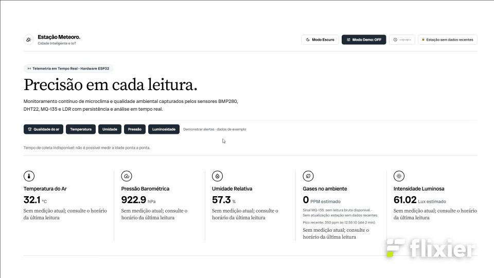
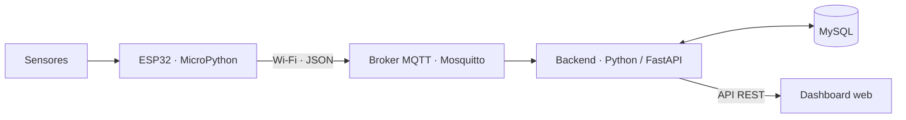
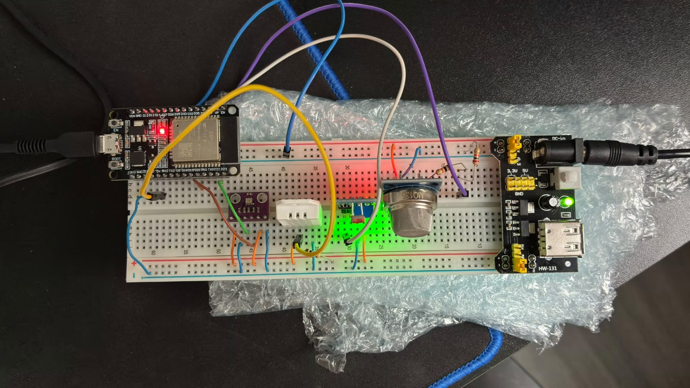

# Estacao_Meteorologica
**[Vídeo de demonstração](link do vídeo)**

Um protótipo de uma estação meteorológica à base de ESP32 e MicroPython, com 4 sensores; Dados coletados são disponibilizados num Dashboard web na nuvem e armazenados numa Database local (MySQL). 
Projeto da aula: Projeto e Desenvolvimento 2, Grupo 3, Professor e Orientador: Marcos

A estação realiza o monitoramento local de temperatura, umidade, pressão, luminosidade e resposta a gases. A solução integra sensores, comunicação MQTT, processamento em Python, armazenamento relacional e visualização web, permitindo acompanhar as condições ambientais e consultar o histórico de leituras.

## Materiais do projeto

| Material | Acesso |
|---|---|
| Documentação técnica (PDF) | [Download do PDF](link_do PDF) |
| Vídeos dos testes (CT01 e CT02) | [CT01 – DHT22](https://drive.google.com/file/d/1qfOrmgAjUG2O6l6WuTXDfgO6E9ntvme1/view?usp=sharing) · [CT02 – Dashboard](https://drive.google.com/file/d/1QA6h5mdb3fsU3ljLW3dawQoIvU-gtH86/view?usp=sharing) · [CT02 – Backend](https://drive.google.com/file/d/1LuOKGA8SUEUM9cJP42ETn0yh3UFG4XHv/view?usp=sharing) |
| Apresentação executiva | [PDF](pdf da apresentação) · [PowerPoint](pptx da apresentação) |
| Montagem no Fritzing e pinagem | [PDF do esquema](pdf do esquema) · [Projeto editável e imagens](Fritzing/) |
| Registros dos testes | [Procedimentos e resultados CT01–CT04](Documentos/Guias/TESTES.md) |
| Interface web | [Dashboard](link do site na web) |



*Trecho de um teste funcional com atualização dos indicadores e acionamento de aviso associado à leitura do MQ-135.*

## Arquitetura



O firmware realiza a aquisição a cada 2,5 segundos. O backend valida as mensagens, aplica filtros e registra as leituras no MySQL. O dashboard apresenta indicadores, gráficos históricos, alertas e a localização cadastrada da estação. A recepção de novas leituras depende da operação da placa, do broker e do backend.

## Protótipo



| Sensor | Grandeza | Conexão na ESP32 |
|---|---|---|
| DHT22 | Temperatura e umidade relativa | GPIO4 |
| BMP280 | Pressão atmosférica | SDA: GPIO21; SCL: GPIO22 |
| LDR | Luminosidade estimada | GPIO35 |
| MQ-135 | Resposta a gases e PPM estimado | GPIO34, após divisor de tensão |

As conexões, a alimentação e o condicionamento dos sinais estão descritos no [guia de hardware](Documentos/Guias/HARDWARE.md).

## Instalação e execução

1. Preparar Python, MySQL e Mosquitto conforme o [guia de instalação](Documentos/Guias/INSTALACAO.md).
2. Configurar o ambiente e transferir os arquivos de `Firmware/` para a ESP32.
3. Iniciar os serviços e acessar a interface conforme o [guia de operação](Documentos/Guias/OPERACAO.md).

## Organização do repositório

```text
Backend/      API, recepção MQTT e filtros
Dashboard/    Interface web
Database/     Esquema SQL e migrações
Firmware/     Programa embarcado e configuração de exemplo
Documentos/         Apresentação, esquema, guias, imagens e evidências
Testes/        Testes automatizados e ensaio de integração
```

## Equipe

| Integrante | RA |
|---|---|
| Arthur da Costa Lemos | H85IJJ7 |
| Artur Américo Brandão | H866189 |
| Marcio Levi Candido Bezerra | H95EBA4 |

A fundamentação teórica, as referências bibliográficas e a análise dos resultados constam no relatório técnico.
